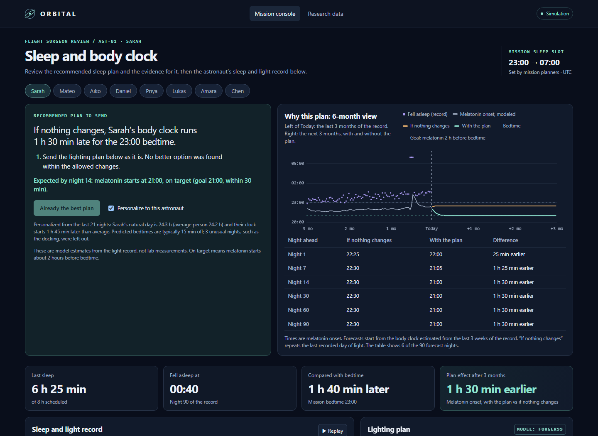

# AstroWatch

A sleep and body-clock dashboard for flight surgeons. It reads an astronaut's sleep and light record, estimates where their body clock is, and recommends a lighting and sleep plan that brings it back in sync with the mission schedule.

Built in 48 hours for the NASA Space Apps Challenge 2026, challenge "Create Health Monitoring Software for Astronauts on Space Missions".



**Live demo:** https://cynthiasalazarb.github.io/astrowatch/

## The problem

On the International Space Station the crew sees 16 sunrises a day and lives under artificial light. Body clocks drift away from the mission's sleep schedule, which leads to short sleep and heavy use of sleep medication. NASA already has tunable LED lights on the station, but no simple way to know when each astronaut needs which light, because everyone's clock is different.

## How it works

1. **Record.** Each astronaut has 90 days of sleep and light data, in 5-minute steps, the shape a wrist actigraph (the Actiwatch NASA crews wear) produces.
2. **Personal fit.** The app adjusts a body-clock model to each astronaut so its predicted bedtimes match their real ones.
3. **Forecast.** It forecasts melatonin onset, the body's "night is starting" signal, for the next 90 nights.
4. **Recommendation.** It searches 108 lighting and sleep plans and recommends the one that puts melatonin onset about 2 hours before the mission bedtime within two weeks, with the fewest changes.
5. **Review.** The flight surgeon sees the plan next to the evidence (3 months of record, 3 months of forecast, with and without the plan) and decides what to send.

## The interesting parts

**A published model, personalized, instead of a trained black box.** The body clock runs on Forger99, a set of three equations from sleep research, ported to the browser from the open-source `arcascope/circadian` package. Only two numbers are fitted per astronaut: how much later or earlier their clock starts, and how long their natural day is (the average is 24.2 h). On test records made from known settings the fit recovers them exactly. On real-looking records it is typically 15 to 40 minutes off. The tradeoff: it can only learn what those two numbers describe, but every recommendation can be explained, and it works with a few weeks of data per person.

**Unusual nights don't drag the fit.** A docking moves everyone's sleep 6 hours for three nights. With plain squared error those nights pushed the fit error to about 100 minutes. Each night's error now counts at most 2 hours, and the dashboard says how many nights were set aside.

## Run it locally

Needs Python 3. No install, no build step.

```bash
python ORBITAL/serve.py
```

Then open http://localhost:8000. `serve.py` is a small wrapper around Python's web server that sends JavaScript modules with the right file type (plain `python -m http.server` breaks them on some Windows setups) and turns off caching.

## Data

| Source | Used for |
|---|---|
| Synthetic crew of 8 (`ORBITAL/dist/crew.mjs`, seeded so it never changes) | The records, fit and recommendations on screen |
| ISS lighting reports (NASA NTRS) | The three station light modes, the 2-hour pre-sleep default, morning light brightness |
| UTMB bed-rest actigraphy (NASA Life Sciences Portal) | Research tab: real sleep numbers from a spaceflight analog |
| NASA DSO 484 (Whitson et al.) | Research tab: proof that timed bright light shifts the astronaut body clock |
| Insomnia and partner actigraphy (Angelova et al. 2021), in `data/` | Real wrist recordings, not yet connected to the app |

The astronauts and their records are fictional. Results are model estimates, not clinical outcomes.

## Tech stack

| Part | Choice |
|---|---|
| App | Plain HTML, CSS and JavaScript modules, canvas charts |
| Body-clock model | Forger99, browser port of `arcascope/circadian` (MIT) |
| Hosting | GitHub Pages via GitHub Actions |
| Local server | Python standard library |

## Repo layout

```
ORBITAL/     the app (the folder kept its original name): dist/ is the site
docs/        screenshot; archive/ holds the plan and design written during the hackathon
data/        light values from NASA reports, real actigraphy recordings (see data/README.md)
```

## Credits

Built by team NASA Gals +1 at NASA Space Apps 2026.

## License

MIT. See [LICENSE](LICENSE). The ported model code keeps its original MIT license in `ORBITAL/dist/LICENSE-arcascope.txt`.
