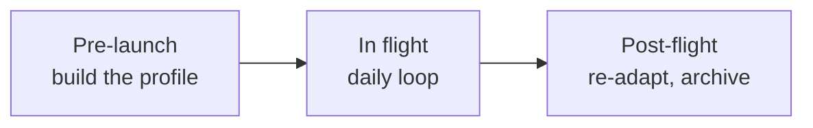
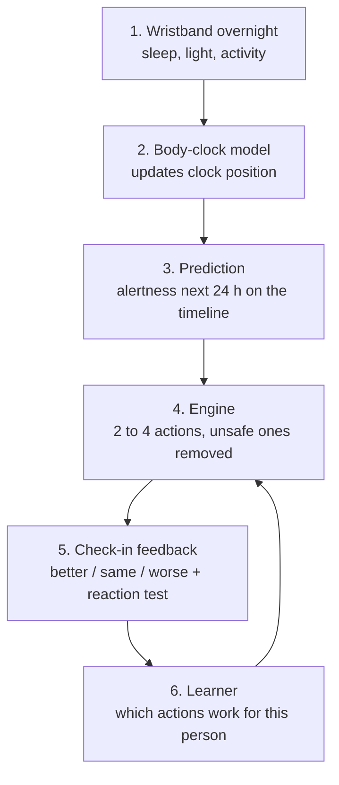

# Data flow: phases, loop and why each dataset

How the data moves through the circadian copilot, and why we use each dataset. Read this before building.
Scope and decisions live in [PLAN.md](PLAN.md).

## The key idea: real product vs our demo

A real astronaut produces data in 3 phases. We do not have real astronaut data (NASA keeps it behind data
requests), so every real data stream has a **stand-in** in our demo.

| Phase | Real mission data | Our demo stand-in |
|---|---|---|
| Pre-launch | Actiwatch weeks, chronotype questionnaire (MEQ), saliva melatonin/cortisol, baseline reaction test | MMASH baseline profiles |
| In flight | Actiwatch (sleep, light, activity), crew timeline, cabin sensors, check-ins | Synthetic wristband data shaped by NASA numbers, synthetic ISS timeline, **real OSDR cabin data**, check-ins clicked in the demo |
| Post-flight | Re-adaptation to Earth, data into NASA's archive | Not built, one pitch slide |

## Phase 1: Pre-launch (training, weeks before flight)

**Goal:** know the person before space scrambles their clock. This solves the cold start: on day 1 in orbit the app
already knows them.

**Learns:** chronotype (morning or night person), usual sleep timing and sleep need, baseline melatonin and cortisol,
normal reaction-test speed.

**Why MMASH:** it is the only open dataset with all of these for the same people: chronotype, sleep, activity,
heart rate, saliva melatonin and cortisol. Each of its 22 people becomes one synthetic astronaut's training phase.

## Phase 2: In flight (the core, what we build)

A loop that runs every day, plus moments during the day ("I feel groggy").

1. **Wristband overnight** records sleep, light and activity.
2. **Body-clock model** ([arcascope/circadian](https://github.com/Arcascope/circadian)) updates where this person's clock is.
3. **Prediction:** sleep pressure + clock position give the alertness curve for the next 24 h, laid over the timeline.
4. **Engine** picks 2 to 4 actions (light mode, nap, caffeine cut-off, movement, sleep window) aimed at critical tasks,
   and removes anything unsafe (breaks the timeline, nap ending under 30 min before a critical task, meds, food).
5. **Feedback** at the check-in: 1 tap, optional reason, reaction test when already scheduled.
6. **Learner** updates which actions it trusts for this person. Next day, repeat.

**Why each dataset here**

| Data | Why |
|---|---|
| Synthetic wristband data | Real astronaut wristband data is not public. We generate it in the Actiwatch shape and calibrate it with NASA numbers: Barger 2014 (about 6 to 6.5 h sleep, low light levels), ISS schedule (GMT, 8.5 h sleep slot), a docking shift. Realistic, not invented. |
| OSDR cabin data (real NASA) | Real ISS CO2, temperature, humidity. NASA's sleep risk graph lists the environment as a cause of bad sleep, so the app flags it. Our strongest NASA data point. |
| Fitbit, Walch | Make the synthetic nights look like real wearable nights: night-to-night variation, heart rate during sleep. |
| Jones 2022, Xiang 2024 | How much reaction time drops after short sleep, so synthetic reaction tests behave like real ones. |
| NASA sleep risk graph (DAG) | The list of causes and effects the engine follows. |
| SSLA lighting spec | The 3 real light modes the app switches: General 4500K, Pre-sleep 2700K, Alertness 6500K. |

## Phase 3: Post-flight

**Real world:** the astronaut re-adapts to Earth's 24 h day; their data goes to NASA's archive, where NASA could one day
train a model across all astronauts.

**For us:** one pitch slide. It is the "we are not training the model, but this is where the training would happen" story.

## What to build first

Everything wraps one core function:

> **Input:** one astronaut's last few days of sleep and light.
> **Output:** tomorrow's alertness curve + the best action before the next critical task.

Build it for one synthetic astronaut first. Then:
- the screens display it,
- the feedback tunes it,
- the simulation runs it for 22 astronauts to produce the numbers.
