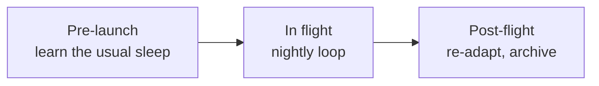
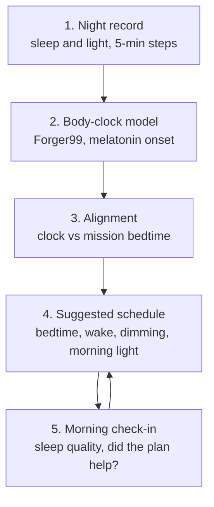

# Data flow: ORBITAL (sleep)

How data moves through ORBITAL and why each dataset is used. Read this before building.
Scope: [PLAN.md](PLAN.md). Components, formats and formulas: [SYSTEM_DESIGN.md](SYSTEM_DESIGN.md).

## The key idea: real mission vs our demo

A real astronaut produces sleep and light data before, during and after a mission. That data is not public, so
every real stream has a **stand-in** in ORBITAL.

| Phase | Real mission | ORBITAL demo |
|---|---|---|
| Pre-launch | weeks of Actiwatch data, habitual bed and wake times | the first nights of a replay, used to fit the personal clock offset |
| In flight | nightly Actiwatch data, mission sleep slot, crew-quarters light | replay nights, suggested schedule, morning check-in, shift planner |
| Post-flight | re-adaptation to Earth, data into NASA's archive | not built, one pitch slide |

## Phase 1: Pre-launch

**Goal:** learn when this person's body clock normally runs before space changes it. On night 1 in orbit, ORBITAL
already knows if they are an early or late sleeper.

**In the demo:** ORBITAL takes the first nights of a replay (nights 1 to 5) and fits a **personal offset**: how
many minutes their clock runs early or late compared with the default model.

## Phase 2: In flight (the core)

A loop that runs every night.

1. **Night record:** sleep state and light (lux) every 5 minutes, from a replay file.
2. **Body-clock model:** Forger99 (browser port of arcascope/circadian) turns the light history into the estimated
   melatonin onset (DLMO), the body's "night starts" signal.
3. **Alignment:** compares DLMO with the mission bedtime. Aligned means DLMO about 2 h before bedtime.
4. **Suggested schedule:** ORBITAL tries bedtime and wake times inside the mission sleep slot, how early the lights
   dim, and morning Alertness light, then proposes the plan that brings the clock back in line within 3 nights.
   Before a known shift (a docking), the shift planner spreads the change over several nights.
5. **Morning check-in:** sleep quality, sleepiness and "did the plan help?". The next suggestion takes the answer
   into account. After 3 nights under 6 h of sleep, ORBITAL shows "talk to the flight surgeon".

## Why each dataset

| Data | Why |
|---|---|
| **ORBITAL synthetic replay** (AST-01, 7 nights) | A controlled story for the demo: bedtime drifts later and the plan has to fix it. Generated by `ORBITAL/generate_mission_telemetry.py`. |
| **Actiwatch partner files** (Angelova et al. 2021, `data/`) | Real per-minute wrist light and sleep/wake from the same Actiwatch family NASA crews wear. They make replays real and let us test the prediction on nights the model has not seen. |
| **UTMB bed-rest actigraphy** (NASA) | Real NASA sleep numbers (duration, time to fall asleep, efficiency) as the reference range on screen. |
| **NASA DSO 484** | NASA evidence that shifting sleep with bright light moves the clock (melatonin peaks before and after). It backs the whole idea and is a sanity check for the model. |
| **ISS crew-quarters lighting guidance** (NASA) | The real fixture modes and the 2 h default pre-sleep dimming that ORBITAL compares against. |
| **`data/light.txt`** (SSLA report, NASA) | Approximate lux for each light setting, so the model gets realistic light instead of illustrative values. |
| **OSDR cabin data** (NASA, optional) | Cabin temperature and CO2, which can disturb sleep. A context note, not a model input. |

Not used anymore after the sleep pivot: MMASH, Fitbit, Walch, Sleep-EDF, reaction-test data.

## Phase 3: Post-flight

**Real world:** the astronaut re-adapts to Earth's 24 h day; their data goes to NASA's archive, where a model across
many astronauts could one day be trained.

**For us:** one pitch slide: "ORBITAL personalizes from each astronaut's own record today; NASA's archive is where a
population model would come next."

## What to build first

Everything wraps one function:

> **Input:** one astronaut's replay (sleep + light).
> **Output:** their clock offset, tonight's alignment, and the suggested schedule with its 3-night forecast.

Build it on AST-01 first, then run it on one real Actiwatch file. The screens show it, the check-in tunes it, and
the results scripts run it over all partner files.
