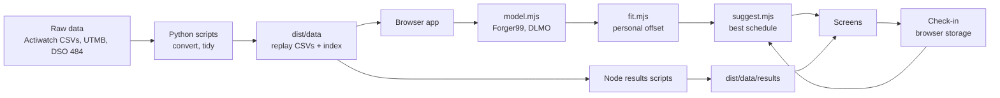

# System design: ORBITAL (sleep)

How ORBITAL is built and what we add to it. Scope and decisions: [PLAN.md](PLAN.md).
The app lives in `ORBITAL/` in this repo (moved from nora-raad/nasa_hackathon with history); paths below are
relative to that folder unless they start with `docs/` or `data/`.

## 0. Repo layout and running it

```
Nasa/
  ORBITAL/     the app: dist/ (served site), generate_mission_telemetry.py, README
  docs/        PLAN.md, SYSTEM_DESIGN.md, DATA_FLOW.md
  data/        raw datasets (Actiwatch exports, light.txt)
  .github/     Pages workflow, deploys ORBITAL/dist on push to main
```

Run locally (Python only, no install, no build), from the repo root:

```bash
python -m http.server 8000 --directory ORBITAL/dist
```

Then open http://localhost:8000. Opening `index.html` directly does not work; the data files load over HTTP.

## 1. Data flow



| Mission phase | Real mission | ORBITAL demo |
|---|---|---|
| Pre-launch | weeks of Actiwatch data, habitual sleep | first nights of a replay, used to fit the personal offset |
| In flight | nightly Actiwatch data, mission sleep slot, crew-quarters light | replay nights, suggested schedule, check-in, shift planner |
| Post-flight | re-adaptation, NASA archive | not built, one pitch slide |

Everything runs in the browser except two offline steps: converting raw files (Python) and computing the results
(Node, using the same `model.mjs` as the app, so there is one model implementation).

## 2. Components

### Existing (keep)
| File | Does |
|---|---|
| `dist/index.html`, `style.css` | Console (replay, lighting preview, forecast) and Research data pages |
| `dist/app.mjs` | loads CSVs, replay controls, plan inputs, renders forecast and evidence |
| `dist/model.mjs` | Forger99 port (RK4, 5-min step), `scheduleLux`, `compare()` returns current vs preview DLMO for 3 nights |
| `dist/charts.mjs` | canvas charts: `drawTelemetry`, `drawPhase`, `drawUtmb` |
| `generate_mission_telemetry.py` | fictional 7-night AST-01 replay |
| `.github/workflows/pages.yml` | deploys `ORBITAL/dist` on every push to main |

### New
| File | Does | Owner |
|---|---|---|
| `dist/fit.mjs` | personal offset and period from a replay (section 4.3) | app + model |
| `dist/suggest.mjs` | candidate schedules, scoring, "why" text, shift planner (4.4, 4.5) | app + model |
| `dist/checkin.mjs` | morning check-in and plan rating in `localStorage` | check-in + results |
| `dist/config.mjs` | lux per fixture setting, thresholds, alignment gap | data |
| `scripts/actiwatch_to_orbital.py` | Actiwatch export to replay CSV + `index.json` (section 3.2) | data |
| `scripts/results/*.mjs` | Node scripts for the 3 results (section 6) | check-in + results |
| `tests/*.mjs` | Node self-checks (section 7) | each owner for their module |

## 3. Data contract

### 3.1 Replay file (existing format, keep)
`dist/data/astronauts/<id>.csv`, one row per 5 minutes, noon-to-noon days, UTC:

| Column | Type | Notes |
|---|---|---|
| `timestamp` | ISO 8601 | `2035-01-01T12:00:00+00:00` |
| `astronaut_id` | string | `AST-01` (synthetic) or `P-<n>` (real partner file) |
| `sleep_state` | `asleep` / `awake` / `gap` | `gap` = off-wrist or missing (new value) |
| `cabin_light_lux` | number | eye-level lux; empty when `gap` |

`app.mjs` currently requires exactly 7 days and finite lux. Change: accept 5 to 14 days and treat `gap` rows as
lux 0 for the model, and skip nights with more than 20% gap in fitting and results.

### 3.2 Actiwatch conversion
Source: Angelova et al. 2021 exports (Actiwatch Spectrum, 1-min epochs). Columns used: `Date`, `Time`,
`Off-Wrist Status`, `White Light`, `Sleep/Wake`, `Interval Status`.
- Resample to 5 min: lux = mean of `White Light`; asleep when most minutes are scored sleep inside a REST interval;
  `gap` when most minutes are off-wrist.
- Cut to whole noon-to-noon days.
- Use PARTNER files (healthy) for the demo and results; CLIENT files (insomnia) only if we show escalation.
- Wrist light is not eye-level light (sleeves, wrist angle). Label it "wrist lux" on screen.

### 3.3 Index
`dist/data/astronauts/index.json`: `[{ "id", "label", "source", "days", "file" }]`. The app shows an astronaut picker
from it. AST-01 stays first.

### 3.4 Check-ins (browser only)
`localStorage` key `orbital.checkins.v1`: list of
`{ astronaut_id, night, sleep_quality (1-5), sleepiness (1-9), plan_rating ("better" | "same" | "worse"), plan_id }`.
No server and no personal data leaves the browser.

### 3.5 Suggestion object
`{ id, bedtime, wake, lead, dim_lux, morning_light_min, dlmo_nights[3], error_min, changes, why }`.

## 4. Calculations

### 4.1 Body clock (existing)
Forger99 with default constants, RK4, 5-min step; initial state stabilized on 14 repeats of the first replay day,
then advanced through the light history. DLMO = modeled core body temperature minimum minus 7 h.

### 4.2 Light per setting (`config.mjs`)
From `data/light.txt` (SSLA report, NTRS 20160005080), approximate mid-module lux:

| Setting | Lux | Used for |
|---|---|---|
| Phase-shift / Alertness default | ~500 | morning light block |
| General default | ~250 | awake hours (replaces the illustrative 300) |
| Pre-sleep default | ~105 (estimated) | dimming lead |
| Off | 0 | sleep |

`scheduleLux` gains an optional morning block: Alertness lux for `morning_light_min` after wake.

### 4.3 Personal fit (`fit.mjs`)
- Parameters: `offset_min` (shifts the stabilization day, -180 to +180 in 15-min steps) and `period_h` (the 24.2 h
  constant, 23.8 to 24.6 in 0.1 steps).
- Predicted sleep onset = DLMO + alignment gap (4.6).
- Grid search minimizing squared error between predicted and observed sleep onset over the fitting nights.
  shortcut: grid search, about 225 short simulations; upgrade to a smarter search only if it feels slow.
- Output shown as "your clock runs X min late/early vs the schedule".

### 4.4 Suggested schedule (`suggest.mjs`)
- Candidates inside the mission sleep slot: bedtime and wake within +/- 60 min of the slot (15-min steps),
  dimming lead 60 to 180 min (30-min steps), pre-sleep lux default or max, morning light 0, 30 or 60 min.
- Score = |night-3 DLMO minus target DLMO| + 10 min per setting changed from the current plan.
- Pick the lowest score. `why` is a template, for example: "Your clock runs 1 h 30 late. Start pre-sleep light at
  21:00 and add 30 min of Alertness light after waking."
- "Apply" fills the existing plan inputs, so the current forecast table and chart show the result.

### 4.5 Shift planner
Input: shift size (h) and day. For each night until the shift, choose the candidate that moves DLMO toward the new
target, limited to 60 min of bedtime change per night. Output: a table of nights with bedtime, wake, light times.

### 4.6 Alignment and alerts
- Target DLMO = target bedtime minus 120 min (alignment gap; verify the reference before the slides).
- Alignment error = DLMO minus target DLMO, in minutes. Green under 30, amber 30 to 90, red over 90.
- Escalation banner: 3 consecutive nights under 6 h of sleep in the replay, text "talk to the flight surgeon".
- The app never suggests medication.

### 4.7 Feedback
The latest `plan_rating` for an astronaut adjusts the next suggestion: "worse" adds 30 min of penalty to schedules
like the rated one (same lead and morning light); "better" removes the change cost for them. Small and visible,
not a learning model.

## 5. Screens

| Area | Content | New or existing |
|---|---|---|
| Header | astronaut picker, escalation banner | new |
| Mission replay | nights, scrubber, light and sleep chart, sleep metrics | existing |
| Your clock | personal offset, alignment color | new |
| Suggested plan | schedule, why, Apply | new |
| Lighting preview + 3-night forecast | inputs, fixture modes, forecast table and chart | existing |
| Shift planner | shift size and day, night-by-night table | new |
| Morning check-in | sleep quality, sleepiness, plan rating | new |
| Research data | UTMB, DSO 484, references | existing |
| Results | the 3 numbers and their charts, read from `dist/data/results/` | new |

## 6. Results (Node, `scripts/results/`)
1. `onset_prediction.mjs`: for each PARTNER file, fit on nights 1 to 5, predict onset on nights 6 and 7. Report
   median absolute error (min), and the same for a simple baseline (mean onset of nights 1 to 5), so the model is
   compared with something.
2. `schedule_comparison.mjs`: for AST-01 and each PARTNER file, night-3 alignment error under (A) current light,
   (B) NASA default 2 h pre-sleep lead, (C) suggested schedule; nights to realign after an 8 h shift.
3. `dso484_check.mjs` (optional): run the DSO 484 protocol through the model, compare predicted and reported delays.
Each writes `dist/data/results/<name>.json` with a fixed input set, so runs are reproducible.

## 7. Checks
- `tests/model.test.mjs`: DLMO exists every night for the AST-01 replay; brighter pre-sleep light delays DLMO.
- `tests/fit.test.mjs`: on a replay generated with a known offset, the fit recovers it within 15 min.
- `tests/convert` (Python asserts): converted files have 288 rows per day and only allowed `sleep_state` values.
- Manual: the app loads locally and on Pages; Apply changes the forecast; a check-in survives a reload.

## 8. Risks
| Risk | Mitigation |
|---|---|
| Wrist lux lower than eye-level lux | label it; results report on onset timing, not light dose |
| Model error (published wearable DLMO about 1 h) | state it on the Results screen |
| Alignment gap of 2 h is an assumption | one constant in `config.mjs`; verify the source |
| Grid search slow on old laptops | run fit once per astronaut and cache in memory |
| Results look circular | the onset test predicts held-out real nights and is compared with a baseline |
